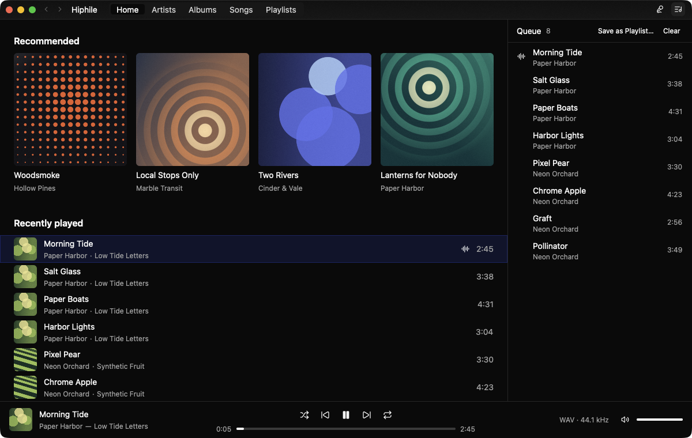
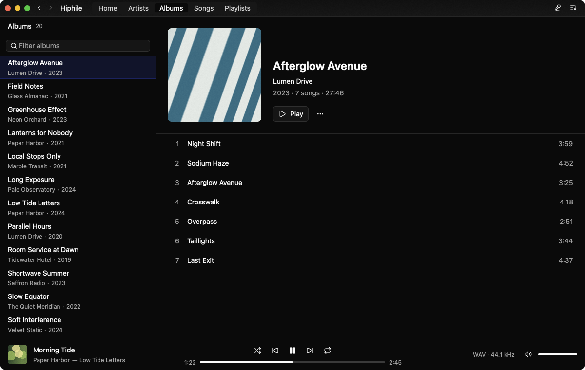
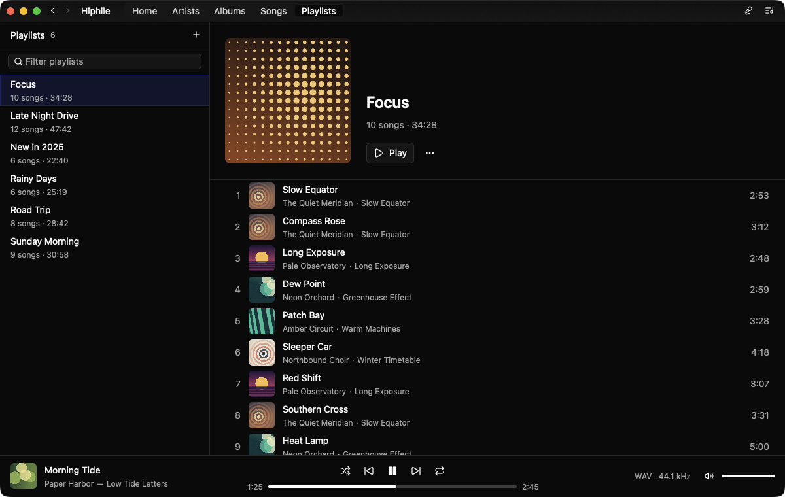
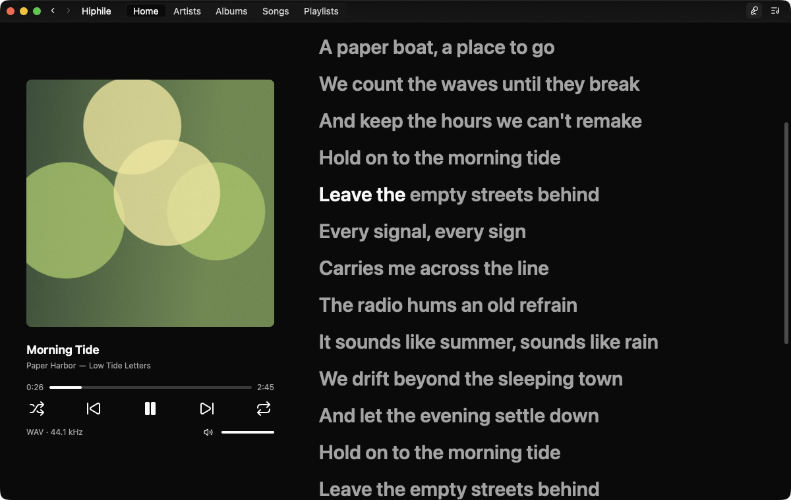

# Hiphile

[English](README.md) | 日本語

Rust と GPUI で構築されたネイティブな Navidrome クライアントで、パフォーマンスを重視しています。

Hiphile は macOS で開発されています。Windows と Linux は定期的なテストを行っていません。



| アルバム | プレイリスト | 歌詞 |
| --- | --- | --- |
|  |  |  |

## 機能

- **ライブラリ:** アルバム、アーティスト、曲の閲覧、ホーム画面でのデイリーおすすめ機能、プレイリストの編集、お気に入り。
- **再生:** ギャップレス再生、リピート、シャッフル、編集可能な再生待ちリスト (キュー)。
- **オーディオ出力:** 出力デバイスの選択、および各ファイルのサンプリングレートに合わせて自動的に切り替える機能。macOS では DoP による DSD256 までの DSD 再生に対応し、フィルターとモジュレーターを調整できます。詳しくは [DSD 出力の仕組み](docs/dsd/implementation.md)(英語)をご覧ください。
- **歌詞:** 同期歌詞、単語単位または行単位でのハイライト表示。
- **ミニプレイヤー:** 再生コントロールと歌詞を表示する、常に最前面の小さなウィンドウ。
- **ローカルキャッシュ:** ライブラリデータ、アルバムアート、楽曲がディスクにキャッシュされ、ライブラリデータはバックグラウンドで同期されます。
- **Scrobbling:** 再生履歴や再生中の曲をサーバーに送信します。オフライン時に再生された分は後から送信されます。
- **メディアコントロール:** メディアキーで再生を操作でき、システムのメディアコントロールに現在再生中の曲を表示します。
- **Discord:** Discord のステータスに現在再生中の曲を表示します。
- **CLI:** ターミナルからの同期、検索、再生。

## インストール

[Releases](https://github.com/heisannn/hiphile/releases) から macOS または Windows 向けのビルドをダウンロードしてください。

ビルドには開発者証明書の署名がないため、システムの警告が表示されます。

- **macOS:** `hiphile.app` をアプリケーションフォルダに移動し、初回起動の前に
  `xattr -dr com.apple.quarantine /Applications/hiphile.app` を実行してください。
- **Windows:** SmartScreen にブロックされた場合は、**詳細情報** を選んでから **実行** を選んでください。

以降は新しいバージョンをアプリが自動でインストールし、次に開いたときから使えます。
**Settings > Updates** でオフにできます。

## はじめに

```sh
cargo run                            # アプリを実行する
cargo run -p hiphile-cli -- --help   # CLIの使用方法を表示する
```

デフォルトでは、CLI はアプリの最新のログイン情報を使用します。コマンドラインオプションや環境変数を指定すると、それが優先されます。

## 設定

設定を変更するには、アプリ内の **hiphile > Settings…** に移動します。設定は `~/.config/hiphile/config.toml` に保存され、パスワードはシステムのキーチェーンに保存されます。

| キー | 環境変数 | デフォルト値 |
| --- | --- | --- |
| `server` | `HIPHILE_SERVER` | なし |
| `username` | `HIPHILE_USERNAME` | なし |
| `output_device` | `HIPHILE_OUTPUT_DEVICE` | システムデフォルト |
| `sample_rate` (Hz) | `HIPHILE_SAMPLE_RATE` | 各ファイルのレート |
| `resampling` (`medium`、`high`、`max`、`custom`) | `HIPHILE_RESAMPLING` | `medium` |
| `resampling_fft_size` (`custom` のとき: 256〜16384 の 2 の累乗) | `HIPHILE_RESAMPLING_FFT_SIZE` | `256` |
| `resampling_window` (`custom` のとき: `hann`、`hann-2`、`blackman`、`blackman-2`、`blackman-harris`、`blackman-harris-2`) | `HIPHILE_RESAMPLING_WINDOW` | `blackman-harris-2` |
| `output_format` (`pcm` または `dsd`。macOS で `dop_device` のデバイスに適用) | `HIPHILE_OUTPUT_FORMAT` | `pcm` |
| `dop_device` (DSD を有効にした出力デバイス) | `HIPHILE_DOP_DEVICE` | なし |
| `dsd_rate` (`64`、`128`、`256`) | `HIPHILE_DSD_RATE` | `256`。設定画面で有効にすると、デバイスの最高レートを選びます |
| `dsd_base_rate` (`44100`、または 48 kHz 系の曲を 48 kHz 基準の DSD レートで再生する `match`。デコードできない DAC もあります) | `HIPHILE_DSD_BASE_RATE` | `44100` |
| `dsd_fade_in` (DSD を有効にしたときや設定を変えたときに、音を 3 秒かけて上げるか) | `HIPHILE_DSD_FADE_IN` | `true` |
| `dsd_quality` (`low`、`medium`、`high`、`max`、`custom`) | `HIPHILE_DSD_QUALITY` | `high` |
| `dsd_filter` (`custom` のとき: `sinc` または `fft`) | `HIPHILE_DSD_FILTER` | `sinc` |
| `dsd_sinc_length` (`sinc` のとき: `256`、`512`、`1024`、`2048`) | `HIPHILE_DSD_SINC_LENGTH` | `1024` |
| `dsd_fft_size` (`fft` のとき: 256〜16384 の 2 の累乗) | `HIPHILE_DSD_FFT_SIZE` | `4096` |
| `dsd_window` (`custom` のとき: `resampling_window` と同じ) | `HIPHILE_DSD_WINDOW` | `blackman-harris-2` |
| `dsd_cutoff` (`sinc` のとき: ソースのナイキスト周波数に対する比。`0.5`〜`1`) | `HIPHILE_DSD_CUTOFF` | リサンプラーが決定 |
| `dsd_order` (`custom` のとき: `3`、`5`、`7`、`9`) | `HIPHILE_DSD_ORDER` | `7` |
| `dsd_noise_gain` (`custom` のとき: `1.2`〜`1.5`) | `HIPHILE_DSD_NOISE_GAIN` | `1.4` |
| `dsd_noise_band` (`custom` のとき: `20000` または `48000`) | `HIPHILE_DSD_NOISE_BAND` | `20000` |
| `dsd_optimized_zeros` (`custom` のとき) | `HIPHILE_DSD_OPTIMIZED_ZEROS` | `true` |
| `dsd_dither_db` (`custom` のとき: `-160`〜`-20`) | `HIPHILE_DSD_DITHER_DB` | なし |
| `dsd_input_level_db` (`custom` のとき: `-24`〜`6`) | `HIPHILE_DSD_INPUT_LEVEL_DB` | `0` |
| `dsd_limiter_ceiling_db` (`custom` のとき: `off`、または `-6`〜`3`) | `HIPHILE_DSD_LIMITER_CEILING_DB` | `1` |
| `song_cache_gib` (`0` は無制限) | `HIPHILE_SONG_CACHE_GIB` | `8` |
| `cover_cache_gib` (`0` は無制限) | `HIPHILE_COVER_CACHE_GIB` | `8` |
| `appearance` (`"light"` または `"dark"`) | `HIPHILE_APPEARANCE` (`system` も指定可能) | システム設定 |
| `lyrics_highlight` (`"word"` または `"line"`) | `HIPHILE_LYRICS_HIGHLIGHT` | `"word"` |
| `romaji_search` (漢字をローマ字で検索。辞書をダウンロードします) | `HIPHILE_ROMAJI_SEARCH` | `true` |
| `discord_presence` (Discord のステータスに現在再生中の曲を表示) | `HIPHILE_DISCORD_PRESENCE` | `true` |
| `auto_update` (新しいバージョンを自動でインストール) | `HIPHILE_AUTO_UPDATE` | `true` |
| `imgbb_api_key` | `HIPHILE_IMGBB_API_KEY` | なし |

## ロードマップ

- [x] 純粋な Rust によるオーディオバックエンド
- [x] デバイスのサンプリングレートの自動切り替え
- [x] ローカル音楽ライブラリのキャッシュ
- [x] あいまい検索 (ファジー検索)
- [x] DoP による DSD 出力

## 免責事項

このプロジェクトは AI によって生成されたものであり、いかなる保証も伴わない「現状有姿」の状態で提供されます。
作者は、データ、アカウント、またはオーディオ機器への損害を含め、本ソフトウェアの使用に起因するいかなる損害や損失に対しても責任を負いません。すべて自己責任においてご使用ください。

hiphile は、Navidrome、Musixmatch、プチリリ (PetitLyrics)、ImgBB、Discord との提携関係はなく、またそれらの承認を受けていません。本ソフトウェアは以下のサードパーティサービスを利用しています：

- **歌詞:** 曲の詳細情報は、Musixmatch およびプチリリの非公開 API を介して送信されます。これらの API は予告なく動作しなくなる可能性があります。また、各サービスの利用規約がこのような利用を禁止している場合があるため、ご自身で規約をご確認ください。
- **Discord上のアルバムアート:** ImgBB の API キーを設定した場合、カバー画像が ImgBB にアップロードされます。アップロードされた画像は、**リンクを知っていれば誰でも 180 日間閲覧可能**になります。キーが設定されていない場合、何もアップロードされません。

## ライセンス

[MIT](LICENSE)。`romaji_search` がダウンロードする辞書には、それぞれのライセンスが適用されます。一覧は
[script/readings-notices/NOTICE.txt](script/readings-notices/NOTICE.txt) にあります。
