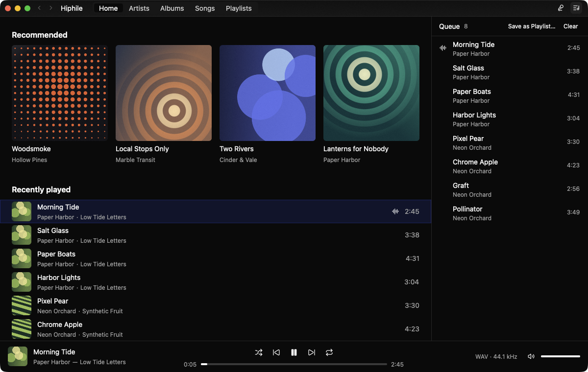
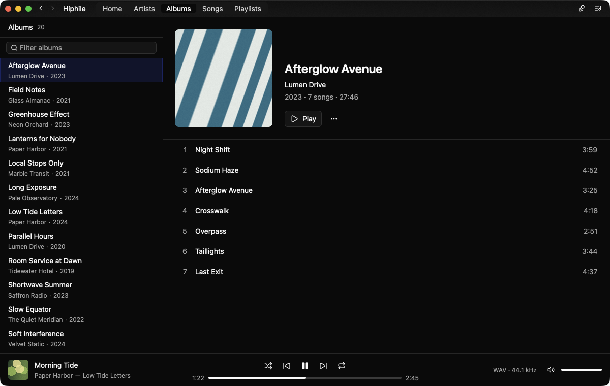
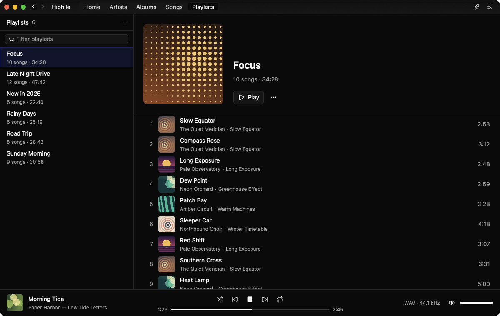
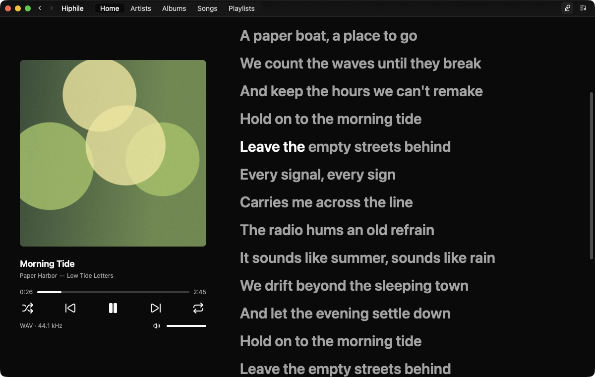

# Hiphile

English | [日本語](README.ja.md)

A native Navidrome client built with Rust and GPUI, with a focus on performance.

Hiphile is developed on macOS. Windows and Linux are not regularly tested.



| Albums | Playlists | Lyrics |
| --- | --- | --- |
|  |  |  |

## Features

- **Library:** Browse albums, artists and songs, get daily recommendations on the home screen, edit playlists, and keep favorites.
- **Playback:** Gapless playback, repeat, shuffle and an editable queue.
- **Audio output:** Choose an output device, and switch its sample rate automatically to match each file.
- **Lyrics:** Synced lyrics, highlighted word by word or line by line.
- **Mini player:** A small window above all others, with the controls and the lyrics.
- **Local cache:** Library data, cover art and songs are cached on disk, and library data syncs in the background.
- **Scrobbling:** Report plays and the current song to your server. Plays made offline are sent later.
- **Media controls:** Control playback with the media keys and see the current song in your system's media controls.
- **Discord:** Show the current song as your Discord status.
- **CLI:** Sync, search and play from the terminal.

## Install

Download a build for macOS or Windows from [Releases](https://github.com/heisannn/hiphile/releases).

The builds are not signed with a developer certificate, so the system warns about them:

- **macOS:** Move `hiphile.app` to Applications, then run
  `xattr -dr com.apple.quarantine /Applications/hiphile.app` before the first launch.
- **Windows:** If SmartScreen stops the app, choose **More info**, then **Run anyway**.

From then on, the app installs new versions by itself, and they start the next time it opens.
Turn this off in **Settings > Updates**.

## Getting started

```sh
cargo run                            # Run the app
cargo run -p hiphile-cli -- --help   # Show CLI usage
```

By default, the CLI uses the app's most recent sign-in. Command-line options and
environment variables override it.

## Configuration

Change settings in the app under **hiphile > Settings…**. They are saved to
`~/.config/hiphile/config.toml`, and your password is saved to the system keychain.

| Key | Environment variable | Default |
| --- | --- | --- |
| `server` | `HIPHILE_SERVER` | None |
| `username` | `HIPHILE_USERNAME` | None |
| `output_device` | `HIPHILE_OUTPUT_DEVICE` | System default |
| `sample_rate` (Hz) | `HIPHILE_SAMPLE_RATE` | Each file's rate |
| `song_cache_gib` (`0` for no limit) | `HIPHILE_SONG_CACHE_GIB` | `8` |
| `cover_cache_gib` (`0` for no limit) | `HIPHILE_COVER_CACHE_GIB` | `8` |
| `appearance` (`"light"` or `"dark"`) | `HIPHILE_APPEARANCE` (also accepts `system`) | System setting |
| `lyrics_highlight` (`"word"` or `"line"`) | `HIPHILE_LYRICS_HIGHLIGHT` | `"word"` |
| `romaji_search` (find kanji by romaji; downloads a dictionary) | `HIPHILE_ROMAJI_SEARCH` | `true` |
| `discord_presence` (show the current song as your Discord status) | `HIPHILE_DISCORD_PRESENCE` | `true` |
| `auto_update` (install new versions by itself) | `HIPHILE_AUTO_UPDATE` | `true` |
| `imgbb_api_key` | `HIPHILE_IMGBB_API_KEY` | None |

## Roadmap

- [x] Pure Rust audio backend
- [x] Automatic device sample rate switching
- [x] Local music library caching
- [x] Fuzzy search

## Disclaimer

This project is AI-generated and is provided "as is", without warranty of any kind.
The author accepts no responsibility for any damage or loss resulting from its use,
including harm to your data, accounts or audio equipment. Use it at your own risk.

hiphile is not affiliated with or endorsed by Navidrome, Musixmatch, PetitLyrics,
ImgBB or Discord. It uses third-party services as follows:

- **Lyrics:** Song details are sent to Musixmatch and PetitLyrics through their
  unpublished APIs, which may stop working at any time. Their terms may prohibit
  this kind of use, so please review them yourself.
- **Cover art on Discord:** If you set an ImgBB API key, cover images are uploaded
  to ImgBB, where **anyone with the link can view them for 180 days**. Without a
  key, nothing is uploaded.

## License

[MIT](LICENSE). The dictionaries that `romaji_search` downloads stay under their own terms, listed
in [script/readings-notices/NOTICE.txt](script/readings-notices/NOTICE.txt).
